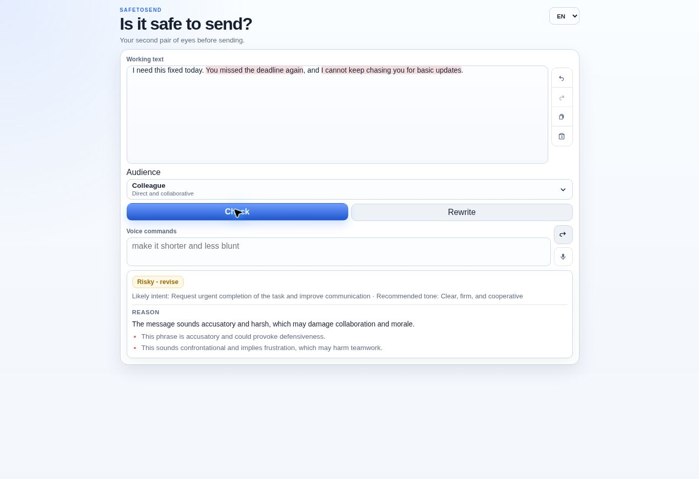

# SafeToSend

I built SafeToSend to see if a model could flag wording that may cause friction while preserving the sender’s intent and tone.

[Try SafeToSend](https://safetosend.vercel.app) with a fictional draft. Compare “I need the update by Friday” with “You clearly have no idea what you are doing. Fix your mess today.” The first is direct. The second adds a personal attack the reader can remove while keeping the request.

## How it works

~~~mermaid
flowchart TD
    A["Draft, audience, and tone preferences"] --> B["Compose the model prompt"]
    B --> C["Validate structured output"]
    C --> D["Verdict and phrase-level feedback"]
    D --> E["Optional rewrite"]
~~~

- [Prompt assembly](lib/assistant-prompts.ts) combines shared checks with audience-specific guidance. The recipient and relationship can change how the same draft lands.
- [Response contracts](lib/assistant-contracts.ts) validate the verdict, cited phrases, and edits with Zod. The client displays the review before offering a rewrite.
- The interface can explain the meaning of an English draft in another language. The sender can check their intended meaning and decide whether to rewrite.
- [Voice input](app/api/transcribe/route.ts) lets the user dictate instructions. [Inference configuration](lib/inference-config.ts) keeps model selection and provider credentials on the server.

## Run and check

Install dependencies and create a local environment file with Node.js 22+.

~~~sh
npm ci
cp .env.example .env.local
~~~

Set the credentials for your selected provider in `.env.local`, then run `npm run dev`.

~~~sh
npm test
npm run typecheck
npm run build
~~~

The [unit tests](tests/) cover contracts, prompt assembly, audio formats, and review state. The [preview regression script](scripts/evaluate-preview.py) runs real model calls against a configured deployment, including cases for direct requests, personal attacks, and tone preservation. Run `python scripts/evaluate-preview.py --help` for options. A live run uses provider quota.
