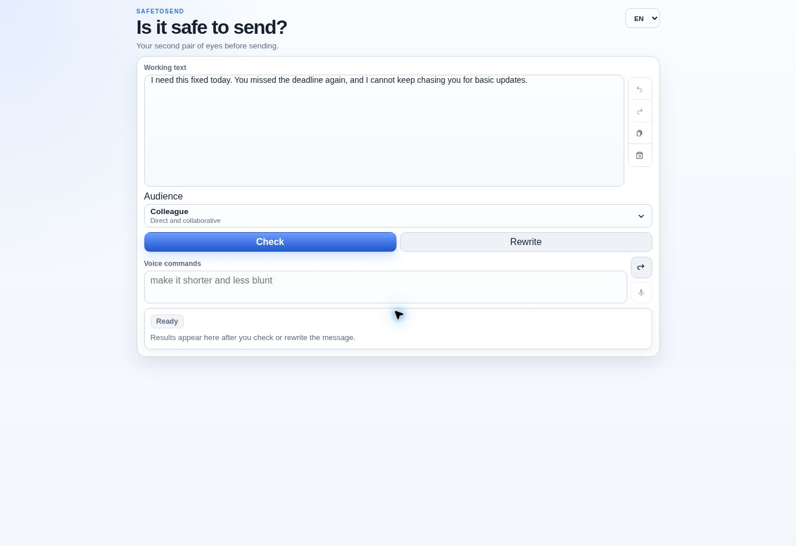
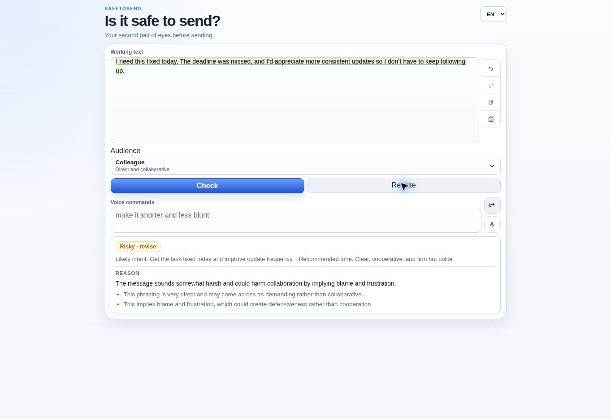
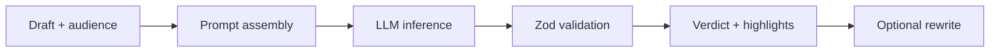

# SafeToSend

**AI-assisted communication risk checker for professional English messages.**

SafeToSend checks whether a message is likely to create avoidable friction, explains the risk in the user's language, and can rewrite the message without discarding its intent.


[Open the deployed prototype](https://safetosend.vercel.app)

## Why it exists

Grammar tools answer “Is this sentence correct?” SafeToSend answers a different question: “Will this message land the way I intend with this audience?”

The app tries to distinguish healthy directness from unnecessary communication risk. It models the recipient, infers the sender's likely goal, and makes risks visible before offering a rewrite. It is a communication aid, not a psychological assessment.

## What it does

- evaluates a draft for a boss, client, colleague, partner, or general audience;
- returns one of three bounded verdicts: safe, revise, or hold;
- highlights the exact phrases that create risk and explains why;
- proposes an intent-preserving rewrite and shows the changes;
- explains meaning in English, Russian, Spanish, German, or French;
- accepts typed or recorded rewrite instructions;
- keeps undo/redo history in the browser.

<details>
<summary>See the synthetic input and rewritten result</summary>

| Draft | Intent-preserving rewrite |
| --- | --- |
|  |  |

</details>

## How it works



The Next.js client sends a typed request to a server route. Prompt modules combine the common analysis policy with audience-specific guidance. The server requests a structured model response, validates it against strict Zod schemas, and returns only the fields the interface can render.

The inference layer supports Vercel AI Gateway, direct OpenAI, and OpenRouter-compatible configuration without exposing provider credentials to the browser.

## A few implementation notes

- **Risk, not grammar:** the rubric focuses on blame, ambiguity, escalation, status mismatch, and avoidable defensiveness.
- **Intent preservation:** analysis records the likely goal and recommended tone; rewrite requests carry that context forward.
- **Bounded outputs:** strict contracts constrain verdicts, highlight severity, edit type, and change lists.
- **Audience-sensitive prompts:** recipient guidance is stored in separate prompt modules instead of duplicated in UI code.
- **Multilingual verification:** the English message is evaluated directly while localized meaning helps the sender verify nuance.
- **Provider abstraction:** model and provider selection are centralized in `lib/inference-config.ts`.
- **Testable prompt assembly:** tests cover schemas, state transitions, prompt composition, and inference configuration.

## Tech stack

Next.js 16, React 19, TypeScript, Vercel AI SDK, OpenAI-compatible providers, Zod, Node's built-in test runner.

## Running locally

Requirements: Node.js 22+ and an API key for the selected inference provider.

```bash
npm ci
cp .env.example .env.local
npm run dev
```

Provider and model settings are documented in `.env.example`. Secrets are read only by server routes.

## Checks

```bash
npm test
npm run typecheck
npm run build
```

## Current state

**Working prototype with a deployed demo.** The repository contains the application, modular prompt library, provider configuration, and automated tests. It is not a clinical or diagnostic product.

## License

No open-source license has been declared.
